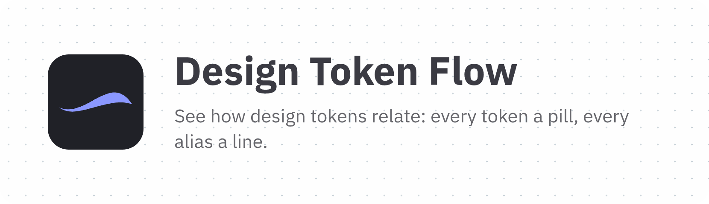

# Design Token Flow

<picture>
  <source media="(prefers-color-scheme: dark)" srcset="./site/public/logo/banner-dark.png">
  
</picture>

[](https://commitizen.github.io/cz-cli/)
[](https://makeapullrequest.com)


[](https://github.com/phun-ky/site-design-token-flow/actions/workflows/check.yml)
[](https://www.bestpractices.dev/projects/16376)
[](https://scorecard.dev/viewer/?uri=github.com/phun-ky/site-design-token-flow)

A site that shows design tokens and how they relate: every token is drawn as a "pill", and lines connect each token to the tokens it references.

**Live:** <https://phun-ky.net/site-design-token-flow/>

> [!IMPORTANT]
> The npm package `@phun-ky/design-token-flow` is deprecated and will not be updated. Its only usable feature, creating design token elements, will be published as its own package.

## What it does

- **[Token flow](https://phun-ky.net/site-design-token-flow/)**: follow any token, such as a button background, through its aliases down to the base value it ends at.
- **[Playground](https://phun-ky.net/site-design-token-flow/playground)**: edit [DTCG 2025.10](https://www.designtokens.org/tr/2025.10/) tokens and see them as pills while you type, with every problem listed.
- Import DTCG or [Tokens Studio](https://tokens.studio/) JSON, and export to either format.
- Publish a document as a link that Tokens Studio syncs from.

Your tokens stay in your browser unless you publish them. The [security policy](SECURITY.md#security-expectations) lists what is stored and where.

## Development

```shell
npm i
npm run dev    # http://localhost:5173
npm test
npm run build
```

The [contributing guide](CONTRIBUTING.md) has the architecture, all scripts and the checks.

## Contributing

See the [contributing guide](CONTRIBUTING.md) for how to report bugs, suggest changes and work on the code, [governance](GOVERNANCE.md) for how decisions are made, and the [roadmap](ROADMAP.md) for what's planned. Report security problems privately, as the [security policy](SECURITY.md) describes.

## Contributors

Original design by [Stefano Tirloni](http://www.stedesign.com/): [Design System Token Map App](https://dribbble.com/shots/14800796-Design-System-Token-Map-App) on Dribbble.

## License

The code is released under the [MIT License](LICENSE).

The bundled fonts keep their own licenses:

- [Inter](site/public/fonts/LICENSE-Inter.txt) and [IBM Plex Sans](site/public/fonts/LICENSE.txt): SIL Open Font License 1.1
- [DejaVu Sans Mono](site/public/fonts/LICENSE-DejaVu.txt): Bitstream Vera license

## Sponsor me

I'm an Open Source evangelist, creating stuff that does not exist yet to help
get rid of secondary activities and to enhance systems already in place, be it
documentation or web sites.

The sponsorship is an unique opportunity to alleviate more hours for me to
maintain my projects, create new ones and contribute to the large community
we're all part of :)

[Support me on GitHub Sponsors](https://github.com/sponsors/phun-ky).
