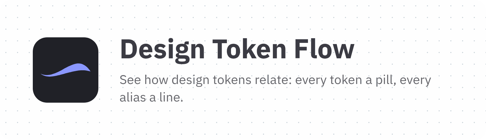

# Design Token Flow

<picture>
  <source media="(prefers-color-scheme: dark)" srcset="./site/public/logo/banner-dark.png">
  
</picture>

[](https://commitizen.github.io/cz-cli/)
[](https://makeapullrequest.com)


[](https://github.com/phun-ky/site-design-token-flow/actions/workflows/check.yml)
[](https://www.bestpractices.dev/projects/16376)
[](https://scorecard.dev/viewer/?uri=github.com/phun-ky/site-design-token-flow)

A site that shows design tokens and how they relate: every token is drawn as a "pill", and lines connect each token to the tokens it references.

**Live:** <https://phun-ky.net/site-design-token-flow/>, deployed to GitHub Pages on every merge to `main`.

> [!IMPORTANT]
> The npm package `@phun-ky/design-token-flow` is deprecated and will not be updated. Its only usable feature, creating design token elements, will be published as its own package.

## Using the site

Nothing to install: open the site in a current browser. Both pages work with a keyboard, and the switch in the header changes between the light and dark theme.

**[Token flow](https://phun-ky.net/site-design-token-flow/)** shows every token as a pill: your own tokens from the playground, or the bundled example file. Base values are on the right, and each alias is joined by a line to the token it references, so you can follow a component token, such as a button background, down to the color it ends at. The sidebar says which tokens are shown, lets you switch between yours and the example, and lists how to move around; on a phone it folds into a bar with an "About this flow" button. A large flow says what it is drawing while it draws.

- **Move around:** scroll with the mouse wheel or two fingers on a trackpad (Shift and the wheel moves sideways), or drag the canvas. With the keyboard, focus it (Tab, or the "Skip to content" link) and use the arrow keys; Shift and an arrow key moves further.
- **Zoom:** Ctrl (Cmd on a Mac) and the mouse wheel, or a pinch on a trackpad, zooms around the pointer, and the zoom buttons in the corner or the `+` and `-` keys zoom in steps. 100% is the flow fitted to the page width: `0` goes back to it, and `F` or "Fit to screen" fits the whole flow on the screen.

**[Playground](https://phun-ky.net/site-design-token-flow/playground)** renders single tokens as pills, so you can try your own. Its sidebar holds where the tokens come from; the editor and the pills sit next to it.

1. Pick the tokens to start from: a showcase with one token of every `$type`, the bundled token file, or your own. "Load a file" opens a `.json` token file of up to 2 MB, and dropping one anywhere on the playground does the same. The file is read in your browser and never uploaded, with its progress and a Cancel button, then checked; when it would replace edits of your own, a dialog compares the two and asks first.
2. Edit the [DTCG 2025.10](https://www.designtokens.org/tr/2025.10/) JSON. The pills update as you type, and the tokens are checked in the background, so a large file doesn't hold up the page. Every problem is listed in the sidebar, naming the token and the field, such as a value that doesn't match its `$type` or a reference to a missing token; select one to move the editor to its line. The valid tokens are still shown.
3. Filter the pills by name or `$type`, and select a pill to see its token, resolved value, the tokens it references and the HTML that renders it, which you can copy. The details open next to the pills, or over the page on a phone; Esc or the close button closes them.

What you type in the playground is saved in your browser, so it is there when you come back, and "Show in the flow" draws it in the flow view. While your edits have problems, the flow shows the last version without. Nothing is sent anywhere: the [security policy](SECURITY.md#security-expectations) lists what the site stores and where.

## Development

```shell
npm i
npm run dev       # http://localhost:5173: flow view, and the pill playground at /playground
npm test
npm run build     # the site, in dist/
npm run preview   # serve dist/
npm run test:e2e  # build, then check the site in Google Chrome (see below)
```

`npm run test:e2e` serves `dist/` like GitHub Pages (`e2e/serve.mjs`, gzipped, under `/site-design-token-flow/`) and runs the Playwright checks in `e2e/` with the installed Google Chrome: requests only to the site's own origin and no console errors, no horizontal scroll at 390, 768 and 1440 px in both themes, no axe violations (WCAG 2.2 A and AA) on any page in either theme, every link and referenced file resolves, zoom, pan, fit, the theme switch and the playground work, script and markup typed into the playground stay text, every page carries its Content Security Policy, the icons, banners and social card are served at their sizes with the mark at 3:1 contrast or more, and each page stays within its performance budget on a throttled phone, the flow view also with a generated file of 976 tokens (`e2e/performance.spec.ts`). CI runs them as "Website checks" and keeps the traces of a failed check.

## Structure

- `site/`: the site's pages. `index.html` is the flow view, `playground.html` lets you edit token JSON and inspect the rendered pills.
- `src/main.ts`: the flow view. It lays tokens out in columns and draws the lines with [`@phun-ky/arclace`](https://www.npmjs.com/package/@phun-ky/arclace).
- `src/assets/data/design-tokens.tokens.json`: the tokens shown, in the [DTCG 2025.10](https://www.designtokens.org/tr/2025.10/) format.
- `src/assets/shiki/`: the code themes of the other phun-ky docs sites, used by the playground's syntax highlighting.
- `site/public/`: copied to the build as they are: the favicon (`favicon.svg`, with `favicon-32.png` and `apple-touch-icon.png` rendered from it by `npm run images:logo`), the wave mark in `logo/` (`mark.svg` for light backgrounds, `mark-dark.svg`, and `mark-mono.svg` in `currentColor`) with the README banners rendered from the favicon, the social card `og-image.png` (1200 by 630, rendered from the site's own pills in a headless browser), and `404.html` with `404.css`, which GitHub Pages serves for any missing path, so its URLs are absolute.
- `site/public/fonts/`: the IBM Plex Sans files the font tokens describe ([SIL Open Font License 1.1](site/public/fonts/LICENSE.txt)). Both pages load them from the tokens, so each font pill is shown in its own face.
- `src/tokens/`: parses token files and renders pills. It is self-contained and will be extracted into its own package; see [its README](src/tokens/README.md).

## Contributing

See the [contributing guide](CONTRIBUTING.md) for how to report bugs, suggest changes and work on the code, [governance](GOVERNANCE.md) for how decisions are made, and the [roadmap](ROADMAP.md) for what's planned. Report security problems privately, as the [security policy](SECURITY.md) describes.

## Contributors

[Stefano Tirloni](http://www.stedesign.com/)
